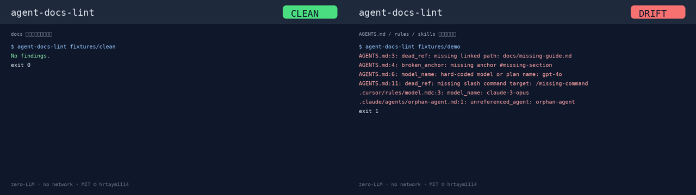

# agent-docs-lint

`agent-docs-lint` is a zero-LLM CLI for catching drift in agent documentation: missing file references, stale model or plan names, unreferenced agent/skill files, and broken local Markdown anchors.

It is designed for `AGENTS.md`, `CLAUDE.md`, `.cursor/rules`, `.claude/agents`, `.claude/skills`, `.agents/skills`, and similar repos where docs are the source of truth.

[](docs/media/agent-docs-lint-howto.gif)

- 🎞️ [GIF（CLEAN ↔ DRIFT）](docs/media/agent-docs-lint-howto.gif) · Release: [v0.1.0](https://github.com/hrtaym1114-github/agent-docs-lint/releases/tag/v0.1.0)

## 使い方（3ステップ）

1. **Install** — `pip install git+https://github.com/hrtaym1114-github/agent-docs-lint.git`
2. **Run** — リポジトリ直下で `agent-docs-lint .`（LLM・ネットワーク不要）
3. **結果** — ズレなし **exit 0** / ズレあり **exit 1**（`--warn-only` で常に 0）

## Install

```sh
pip install git+https://github.com/hrtaym1114-github/agent-docs-lint.git
```

For local development:

```sh
python3 -m venv .venv
.venv/bin/pip install -e '.[dev]'
```

## Usage

```sh
agent-docs-lint [PATH]
agent-docs-lint fixtures/demo --json
agent-docs-lint . --warn-only
agent-docs-lint . --config agent-docs-lint.toml
```

Exit codes:

- `0`: no error findings, or `--warn-only` was used
- `1`: one or more error findings
- `2`: CLI/config/runtime error

## Checks

- `dead_ref`: local Markdown links, backtick path-like references, or slash commands that point to missing files or command targets.
- `model_name`: hard-coded model or plan tokens from a configurable list.
- `unreferenced_agent`: agent/skill Markdown files that are not mentioned by filename stem.
- `broken_anchor`: local Markdown links with a missing `#anchor` in the target file.

## Example Output

```text
AGENTS.md:3: dead_ref: missing linked path: docs/missing-guide.md
AGENTS.md:4: broken_anchor: missing anchor #missing-section in docs/onboarding.md
AGENTS.md:6: model_name: hard-coded model or plan name: gpt-4o
AGENTS.md:11: dead_ref: missing slash command target: /missing-command
.claude/agents/orphan-agent.md:1: unreferenced_agent: agent or skill file is not referenced by name: orphan-agent
```

JSON output is available with `--json`.

## Configuration

Create `agent-docs-lint.toml` or `.agent-docs-lint.toml` at the scan root, or pass `--config PATH`.

```toml
model_names = ["gpt-4", "gpt-4o", "claude-3-opus", "ChatGPT Plus"]
ignore_paths = ["archive/**"]
disable_rules = ["model_name"]
extra_scan_globs = ["docs/agents/**/*.md"]
```

## GitHub Actions

Also see [`docs/github-actions.md`](docs/github-actions.md).

Do not commit this repository with a workflow unless you intend to publish one. This snippet is documentation only:

```yaml
name: agent-docs-lint

on:
  pull_request:
  push:
    branches: [main]

jobs:
  lint-agent-docs:
    runs-on: ubuntu-latest
    steps:
      - uses: actions/checkout@v4
      - uses: actions/setup-python@v5
        with:
          python-version: "3.12"
      - run: pip install git+https://github.com/hrtaym1114-github/agent-docs-lint.git
      - run: agent-docs-lint .
```

## Demo GIF

Release Desk placeholder: add a short GIF later showing `agent-docs-lint fixtures/demo` failing with all four rule families, followed by `agent-docs-lint fixtures/demo --json`.

## 日本語

`agent-docs-lint` は、エージェント運用ドキュメントのズレを検出する標準ライブラリのみの CLI です。存在しない参照、固定されたモデル名、未参照の agent/skill、壊れた Markdown アンカーをローカルと CI で確認できます。
